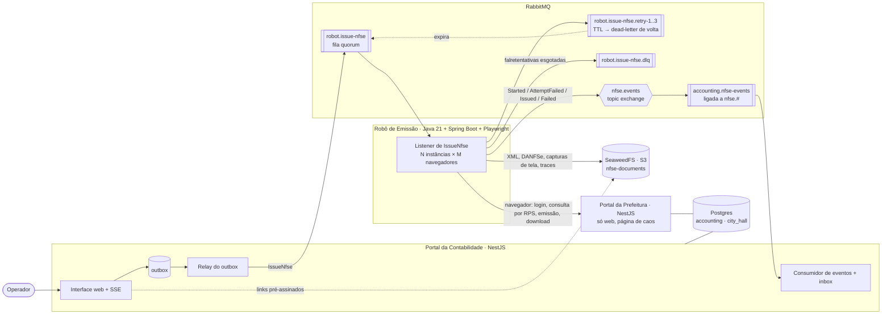

# POC de Automação de NFS-e

Uma prova de conceito para portfólio que demonstra duas coisas:

- **Arquitetura orientada a eventos**: comandos de ida e eventos de volta via RabbitMQ, com transactional outbox, inbox, retentativas por filas de atraso, DLQ e contratos AsyncAPI compartilhados entre Node e Java.
- **Automação de navegador resiliente**: um robô Playwright emite notas fiscais de serviço (NFS-e) em um portal de prefeitura que falha de propósito. Ele sobrevive a sessões expiradas, páginas de manutenção, erros HTTP 500, captchas e respostas que nunca chegam, sem nunca emitir a mesma NFS-e duas vezes.

> **Tudo aqui é fictício.** O Portal da Prefeitura é um simulador construído para esta POC. Todos os CNPJs, credenciais e documentos são fictícios, e todo DANFSe leva a marca d'água "sem valor fiscal". **Nenhuma NFS-e real é emitida**, e nada se comunica com uma prefeitura de verdade.

## Início rápido

Requisitos: Docker com Compose v2 e as portas 3000, 3001, 5432, 5672, 15672 e 8333 livres.

```bash
docker compose up -d --build --wait
```

O primeiro build baixa o Chromium para o robô e leva alguns minutos.

| O quê | URL |
| --- | --- |
| Portal da Contabilidade | http://localhost:3000 |
| Portal da Prefeitura (fictício) | http://localhost:3001 (login `acme` / `acme-pass`) |
| Página de caos | http://localhost:3001/admin/chaos |
| Gerenciamento do RabbitMQ | http://localhost:15672 (`poc` / `poc`) |

Comece cada demonstração de um estado limpo com `docker compose down -v`. Dados de uma execução anterior (por exemplo, um RPS já emitido) são tratados corretamente, mas deixam a demonstração mais difícil de acompanhar.

## Arquitetura



| Componente | Papel |
| --- | --- |
| [Portal da Contabilidade](services/accounting-portal/README.md) | Cria Solicitações de Emissão. Envia `IssueNfse` por um transactional outbox e aplica os eventos do robô (com inbox e status que só avançam). Mostra uma linha do tempo ao vivo via SSE, os documentos, os artefatos de falha e o Reprocessamento. |
| [Robô de Emissão](services/invoice-robot/README.md) | Consome `IssueNfse` e opera as páginas da Prefeitura com Playwright. Consulta o RPS antes de cada emissão, guarda os documentos como claim check e publica eventos. Agenda retentativas, estaciona comandos com falha na DLQ e registra uma captura de tela e um trace de cada tentativa que falhou. |
| [Portal da Prefeitura](services/city-hall-portal/README.md) | Portal de prefeitura fictício: login, emissão e consulta de NFS-e, XML e DANFSe. Não sabe nada de RabbitMQ. Sua página de caos injeta latência, erros HTTP 500, expiração de sessão, timeouts fantasmas, manutenção e captcha. |
| RabbitMQ | Topologia declarada como infraestrutura em [`infra/rabbitmq/definitions.json`](infra/rabbitmq/definitions.json). |
| Postgres | Um banco por portal (`accounting`, `city_hall`). O robô não guarda estado. |
| SeaweedFS (S3) | Bucket `nfse-documents`: XML da NFS-e, PDF do DANFSe, capturas de tela de falhas e traces do Playwright. |

### Fluxo de mensagens

```text
Portal da Contabilidade ── IssueNfse (comando) ──▶ robot.issue-nfse ──▶ Robô de Emissão
          ▲                                                                   │
          └── accounting.nfse-events ◀── nfse.events (topic) ◀── eventos ─────┘
               NfseIssuanceStarted · NfseIssuanceAttemptFailed · NfseIssued · NfseIssuanceFailed
```

Toda mensagem usa o mesmo envelope: `messageId`, `correlationId`, `causationId`, `type`, `version`, `occurredAt`, `payload`. Um mesmo `correlationId` acompanha a Solicitação nos logs dos dois serviços.

## Documentos de design

- **Contratos**: [`contracts/asyncapi.yaml`](contracts/asyncapi.yaml) (AsyncAPI 3), além de JSON Schemas e exemplos em [`contracts/`](contracts/). Os dois serviços validam contra eles toda mensagem que enviam e recebem.
- **Glossário**: [`GLOSSARY.md`](GLOSSARY.md) cobre Escritório Contábil, Prestador, Tomador, Solicitação de Emissão, RPS, DANFSe, Reprocessamento e outros termos.
- **ADRs** (em inglês):
  - [0001 O Portal da Prefeitura fica fora do sistema de mensageria](docs/adr/0001-city-hall-portal-outside-messaging.md)
  - [0002 O número do RPS é a chave de idempotência, consultada antes de cada emissão](docs/adr/0002-rps-as-idempotency-key.md)
  - [0003 Comandos de ida, eventos de volta, com contratos AsyncAPI](docs/adr/0003-commands-out-events-back-with-asyncapi.md)
  - [0004 Claim check em armazenamento de objetos compatível com S3 para os documentos da NFS-e](docs/adr/0004-claim-check-for-documents.md)

## Roteiro de demonstração

Execute a partir de um clone novo. Cada passo diz o que observar.

### 1. Caminho feliz: criar → enviar → Emitida

1. `docker compose down -v && docker compose up -d --build --wait`
2. Abra http://localhost:3000 e clique em **Nova Solicitação**. Mantenha **ACME Tecnologia Ltda** e o primeiro Serviço, preencha um Tomador (qualquer CNPJ, por exemplo `22.222.222/0001-22`), um valor (`1500.00`), a Competência (`2026-11`; `11/2026` também é aceito) e uma Discriminação, e clique em **Salvar como Rascunho**.
3. Clique em **Emitir**. Sem recarregar a página, o status passa por **Enviada → Em processamento → Emitida**: os eventos chegam à página via SSE.
4. A página mostra o número da NFS-e e o código de verificação, com links para o **XML** e o **DANFSe (PDF)** servidos pelo armazenamento de objetos.
5. Entre em http://localhost:3001 como `acme` / `acme-pass`. Em **Consultar NFS-e por RPS**, o mesmo RPS mostra a mesma NFS-e.
6. Correlação: copie o correlation ID da Solicitação e execute `docker compose logs | grep <correlation-id>`. Aparecem linhas tanto do Portal da Contabilidade quanto do robô.

### 2. Caos → observe a recuperação

1. Abra http://localhost:3001/admin/chaos, marque **Manutenção programada** e clique em **Aplicar**.
2. Crie e envie uma nova Solicitação. A linha do tempo mostra **Tentativa falhou** (`Erro transitório: Prefeitura under scheduled maintenance`), com os links **Captura de tela** e **Trace do Playwright**. A captura de tela é exatamente a página de manutenção que o robô encontrou. Abra o trace com `npx playwright show-trace trace.zip` ou em https://trace.playwright.dev.
3. Desmarque **Manutenção programada** e clique em **Aplicar**. Em cerca de 10 s (o primeiro intervalo de retentativa), a retentativa roda e a Solicitação fica **Emitida**.
4. Teste as outras falhas da mesma forma, uma por vez:
   - **Sessão expira na emissão** em 100%: o robô faz login de novo no meio do fluxo, e a emissão ainda dá certo na mesma tentativa.
   - **Captcha no login**: resolvido, sem falha visível.
   - **Erro 500 na emissão** em 50%: algumas tentativas falham e são repetidas.
   - **Timeout fantasma na emissão** em 100%: a Prefeitura emite a NFS-e, mas a resposta nunca chega. A retentativa encontra a NFS-e pelo RPS e a reporta, sem submeter de novo. Entre na Prefeitura como `acme`: existe exatamente **uma** NFS-e para aquele RPS.

   Ao terminar, volte tudo para 0 / desmarcado.

### 3. Escale os robôs

```bash
docker compose up -d --scale invoice-robot=3 --wait
for i in $(seq 1 9); do
  loc=$(curl -s -o /dev/null -w '%{redirect_url}' -X POST localhost:3000/solicitacoes \
    --data-urlencode prestadorCnpj=11.111.111/0001-11 -d servicoCode=01.07 \
    --data-urlencode tomadorCnpj=22.222.222/0001-22 -d tomadorName="Tomador $i" \
    -d amount=100.00 -d competencia=2026-11 -d discriminacao="Lote $i")
  curl -s -o /dev/null -X POST "$loc/emitir"
done
docker compose logs invoice-robot | grep 'Issuing NFS-e'
```

As linhas de log trazem o hostname de cada instância. Os comandos se distribuem entre as instâncias (consumidores concorrentes), e cada instância roda até 3 navegadores ao mesmo tempo. Em http://localhost:3000, as nove ficam **Emitida**.

### 4. DLQ → Reprocessamento

O backoff padrão é de 10 s, 1 min e 5 min. Encurte-o para a demonstração:

```bash
RETRY_DELAYS=3s,3s,3s docker compose up -d --scale invoice-robot=1 --wait invoice-robot
```

1. Na página de caos, ajuste **Erro 500 na emissão** para `100` e clique em **Aplicar**.
2. Crie e envie uma Solicitação. A linha do tempo mostra quatro entradas **Tentativa falhou**, cada uma com sua captura de tela e seu trace, e depois **Emissão falhou**: `Retries exhausted: …`. O status fica **Falhou**.
3. No gerenciamento do RabbitMQ (http://localhost:15672, **Queues and Streams**), `robot.issue-nfse.dlq` guarda o comando estacionado (**Get messages** mostra os headers `x-final-attempt` e `x-failure-reason`).
4. Volte **Erro 500 na emissão** para `0` e clique em **Aplicar**.
5. Na Solicitação, clique em **Reprocessar**. Um novo `IssueNfse` com o **mesmo RPS** é enviado, e o status passa por **Enviada → Em processamento → Emitida**. Reutilizar o RPS garante que um Reprocessamento nunca gere uma segunda NFS-e (ADR 0002).

### 5. Limpeza

```bash
docker compose down -v
```

## Testes

Cada serviço é testado na sua fronteira, contra infraestrutura real em Testcontainers (requer Docker):

| Fronteira | Comando | O que comprova |
| --- | --- | --- |
| Contratos | `cd contracts && npm install && npm test` | Os exemplos são válidos, mensagens inválidas são rejeitadas e o documento AsyncAPI é interpretado sem erros |
| 1 · Robô de Emissão | `cd services/invoice-robot && mvn test` (Java 21) | Caminho feliz, retentativas sob caos, DLQ, expiração de sessão, manutenção, captcha, credenciais erradas, timeout fantasma e idempotência na reentrega, concorrência e artefatos de falha. Roda contra a imagem real da Prefeitura, as definições do RabbitMQ e o S3 |
| 2 · Portal da Contabilidade | `cd services/accounting-portal && npm install && npm test` | Outbox e indisponibilidade do broker, envios concorrentes, transições de status, inbox, eventos fora de ordem e inválidos, SSE, Reprocessamento, validação da Competência e links de documentos e artefatos |
| 3 · Ponta a ponta | `cd e2e && npm install && npm test` | O stack completo do compose: Emitida, a NFS-e na Prefeitura, os dois documentos baixados e um único correlation ID nos logs |

## Estrutura do repositório

```text
contracts/               AsyncAPI + JSON Schemas + exemplos (compartilhados entre Node e Java)
services/
├── accounting-portal/   Portal da Contabilidade (NestJS, Prisma, HTMX)
├── invoice-robot/       Robô de Emissão (Java 21, Spring Boot, Playwright)
└── city-hall-portal/    Portal da Prefeitura fictício (NestJS, Prisma)
infra/                   definições do RabbitMQ, init do Postgres, config do S3, credenciais fictícias do robô
e2e/                     teste de fumaça ponta a ponta sobre o docker compose
docs/adr/                registros de decisões de arquitetura
GLOSSARY.md              linguagem do domínio
```
