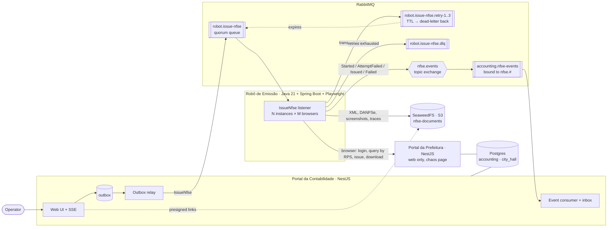

# NFS-e Automation POC

A portfolio proof of concept for two things:

- **Event-driven architecture**: commands out and events back over RabbitMQ, with a transactional outbox, an inbox, retries through delay queues, a DLQ and AsyncAPI contracts shared by Node and Java.
- **Resilient browser automation**: a Playwright robot that issues service invoices (NFS-e) on a city hall portal that misbehaves on purpose. It survives expired sessions, maintenance pages, HTTP 500s, captchas and responses that never arrive, and it never issues the same NFS-e twice.

> **Everything here is fake.** The Portal da Prefeitura is a simulator built for this POC. Every CNPJ, credential and document is fictitious, and every DANFSe is watermarked "sem valor fiscal". **No real NFS-e is ever issued**, and nothing talks to a real city hall.

## Quick start

Requirements: Docker with Compose v2, plus free ports 3000, 3001, 5432, 5672, 15672 and 8333.

```bash
docker compose up -d --build --wait
```

The first build downloads Chromium for the robot and takes a few minutes.

| What | URL |
| --- | --- |
| Portal da Contabilidade | http://localhost:3000 |
| Portal da Prefeitura (fake) | http://localhost:3001 (login `acme` / `acme-pass`) |
| Chaos page | http://localhost:3001/admin/chaos |
| RabbitMQ management | http://localhost:15672 (`poc` / `poc`) |

Start every demo from a clean state with `docker compose down -v`. Leftover data from an earlier run (for example an RPS that was already issued) is handled correctly, but it makes the demo harder to follow.

## Architecture



| Piece | Role |
| --- | --- |
| [Portal da Contabilidade](services/accounting-portal/README.md) | Creates Solicitações de Emissão. Dispatches `IssueNfse` through a transactional outbox and applies the robot's events (with an inbox, forward-only statuses). Shows a live timeline over SSE, the documents, the failure artifacts and Reprocessamento. |
| [Robô de Emissão](services/invoice-robot/README.md) | Consumes `IssueNfse` and drives the Prefeitura's pages with Playwright. Looks up the RPS before every issuance, stores the documents as a claim check and publishes events. Schedules retries, parks failed commands in the DLQ and records a screenshot and trace of each failed attempt. |
| [Portal da Prefeitura](services/city-hall-portal/README.md) | Fake city hall portal: login, NFS-e issuance and lookup, XML and DANFSe. It knows nothing about RabbitMQ. Its chaos page injects latency, HTTP 500s, session expiry, phantom timeouts, maintenance and a captcha. |
| RabbitMQ | Topology declared as infrastructure in [`infra/rabbitmq/definitions.json`](infra/rabbitmq/definitions.json). |
| Postgres | One database per portal (`accounting`, `city_hall`). The robot is stateless. |
| SeaweedFS (S3) | Bucket `nfse-documents`: NFS-e XML, DANFSe PDF, failure screenshots and Playwright traces. |

### Message flow

```text
Portal da Contabilidade ── IssueNfse (command) ──▶ robot.issue-nfse ──▶ Robô de Emissão
          ▲                                                                   │
          └── accounting.nfse-events ◀── nfse.events (topic) ◀── events ──────┘
               NfseIssuanceStarted · NfseIssuanceAttemptFailed · NfseIssued · NfseIssuanceFailed
```

Every message uses one envelope: `messageId`, `correlationId`, `causationId`, `type`, `version`, `occurredAt`, `payload`. One `correlationId` follows a Solicitação through both services' logs.

## Design documents

- **Contracts**: [`contracts/asyncapi.yaml`](contracts/asyncapi.yaml) (AsyncAPI 3), plus JSON Schemas and examples in [`contracts/`](contracts/). Both services validate every message they send and receive against them.
- **Glossary**: [`GLOSSARY.md`](GLOSSARY.md) covers Escritório Contábil, Prestador, Tomador, Solicitação de Emissão, RPS, DANFSe, Reprocessamento and more.
- **ADRs**:
  - [0001 Portal da Prefeitura stays outside the messaging system](docs/adr/0001-city-hall-portal-outside-messaging.md)
  - [0002 RPS number is the idempotency key, checked before every issuance](docs/adr/0002-rps-as-idempotency-key.md)
  - [0003 Commands out, events back, with AsyncAPI contracts](docs/adr/0003-commands-out-events-back-with-asyncapi.md)
  - [0004 Claim check on S3-compatible object storage for NFS-e documents](docs/adr/0004-claim-check-for-documents.md)

## Demo script

Run it from a fresh clone. Each step says what to look at.

### 1. Happy path: create → dispatch → Emitida

1. `docker compose down -v && docker compose up -d --build --wait`
2. Open http://localhost:3000 and click **Nova Solicitação**. Keep **ACME Tecnologia Ltda** and its first Serviço, fill in a Tomador (any CNPJ, e.g. `22.222.222/0001-22`), an amount (`1500,00`), the Competência and a Discriminação, then click **Salvar como Rascunho**.
3. Click **Emitir**. Without reloading, the status goes **Enviada → Em processamento → Emitida**: events are pushed to the page over SSE.
4. The page shows the NFS-e number and verification code, with links to the **XML** and the **DANFSe (PDF)** served from object storage.
5. Log in to http://localhost:3001 as `acme` / `acme-pass`. Under **Consultar NFS-e por RPS**, the same RPS shows the same NFS-e.
6. Correlation: copy the Solicitação's correlation ID and run `docker compose logs | grep <correlation-id>`. Lines from both the Portal da Contabilidade and the robot appear.

### 2. Chaos → watch recovery

1. Open http://localhost:3001/admin/chaos, check **Manutenção programada** and click **Aplicar**.
2. Create and dispatch a new Solicitação. The timeline shows **Tentativa falhou** (`Erro transitório: Prefeitura under scheduled maintenance`), with **Captura de tela** and **Trace do Playwright** links. The screenshot is exactly the maintenance page the robot hit. Open the trace with `npx playwright show-trace trace.zip` or at https://trace.playwright.dev.
3. Uncheck **Manutenção programada** and click **Aplicar**. Within about 10 s (the first retry delay), the retry runs and the Solicitação becomes **Emitida**.
4. Try the other faults the same way, one at a time:
   - **Sessão expira na emissão** at 100%: the robot logs in again mid-flow, and the issuance still succeeds in the same attempt.
   - **Captcha no login**: solved, with no visible failure.
   - **Erro 500 na emissão** at 50%: some attempts fail and are retried.
   - **Timeout fantasma na emissão** at 100%: the Prefeitura issues the NFS-e, but the response never arrives. The retry finds the NFS-e by RPS and reports it, so it never submits again. Log in to the Prefeitura as `acme`: there is exactly **one** NFS-e for that RPS.

   Set everything back to 0/unchecked when you're done.

### 3. Scale the robots

```bash
docker compose up -d --scale invoice-robot=3 --wait
for i in $(seq 1 9); do
  loc=$(curl -s -o /dev/null -w '%{redirect_url}' -X POST localhost:3000/solicitacoes \
    --data-urlencode prestadorCnpj=11.111.111/0001-11 -d servicoCode=01.07 \
    --data-urlencode tomadorCnpj=22.222.222/0001-22 -d tomadorName="Tomador $i" \
    -d amount=100.00 -d competencia=2026-11 -d discriminacao="Lote $i")
  curl -s -o /dev/null -X POST "$loc/emitir"
done
docker compose logs invoice-robot | grep 'Issuing NFS-e'
```

The log lines carry each instance's hostname. The commands are spread across the instances (competing consumers), and each instance runs up to 3 browsers at once. On http://localhost:3000, all nine become **Emitida**.

### 4. DLQ → Reprocessamento

The default backoff is 10 s, 1 min and 5 min. Shorten it for the demo:

```bash
RETRY_DELAYS=3s,3s,3s docker compose up -d --scale invoice-robot=1 --wait invoice-robot
```

1. On the chaos page, set **Erro 500 na emissão** to `100` and click **Aplicar**.
2. Create and dispatch a Solicitação. The timeline shows four **Tentativa falhou** entries, each with its screenshot and trace, then **Emissão falhou**: `Retries exhausted: …`. The status is **Falhou**.
3. In RabbitMQ management (http://localhost:15672, **Queues and Streams**), `robot.issue-nfse.dlq` holds the parked command (**Get messages** shows the `x-final-attempt` and `x-failure-reason` headers).
4. Set **Erro 500 na emissão** back to `0` and click **Aplicar**.
5. On the Solicitação, click **Reprocessar**. A new `IssueNfse` with the **same RPS** goes out, and the status moves **Enviada → Em processamento → Emitida**. Reusing the RPS means a Reprocessamento can never produce a second NFS-e (ADR 0002).

### 5. Clean up

```bash
docker compose down -v
```

## Tests

Each service is tested at its boundary, against real infrastructure in Testcontainers (Docker required):

| Seam | Command | What it proves |
| --- | --- | --- |
| Contracts | `cd contracts && npm install && npm test` | The examples are valid, invalid messages are rejected and the AsyncAPI document parses |
| 1 · Robô de Emissão | `cd services/invoice-robot && mvn test` (Java 21) | Happy path, chaos retries, DLQ, session expiry, maintenance, captcha, bad credentials, phantom timeout and redelivery idempotency, concurrency, failure artifacts. Runs against the real Prefeitura image, RabbitMQ definitions and S3 |
| 2 · Portal da Contabilidade | `cd services/accounting-portal && npm install && npm test` | Outbox and broker outage, dispatch races, status transitions, inbox, out-of-order and invalid events, SSE, Reprocessamento, document and artifact links |
| 3 · End to end | `cd e2e && npm install && npm test` | The whole compose stack: Emitida, the NFS-e at the Prefeitura, both documents downloaded, one correlation ID across the logs |

## Repository layout

```text
contracts/               AsyncAPI + JSON Schemas + examples (shared by Node and Java)
services/
├── accounting-portal/   Portal da Contabilidade (NestJS, Prisma, HTMX)
├── invoice-robot/       Robô de Emissão (Java 21, Spring Boot, Playwright)
└── city-hall-portal/    fake Portal da Prefeitura (NestJS, Prisma)
infra/                   RabbitMQ definitions, Postgres init, S3 config, fake robot credentials
e2e/                     end-to-end smoke test over docker compose
docs/adr/                architecture decision records
GLOSSARY.md              domain language
```
